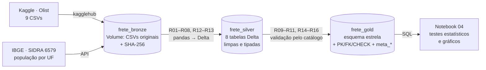
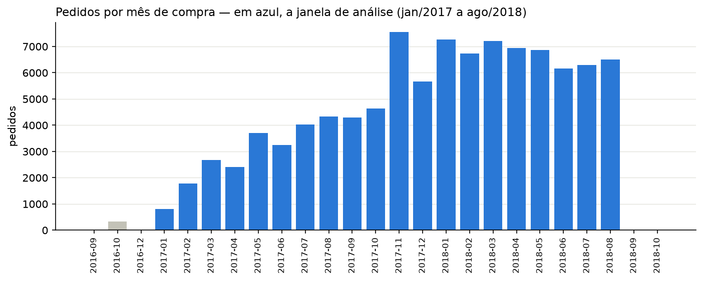
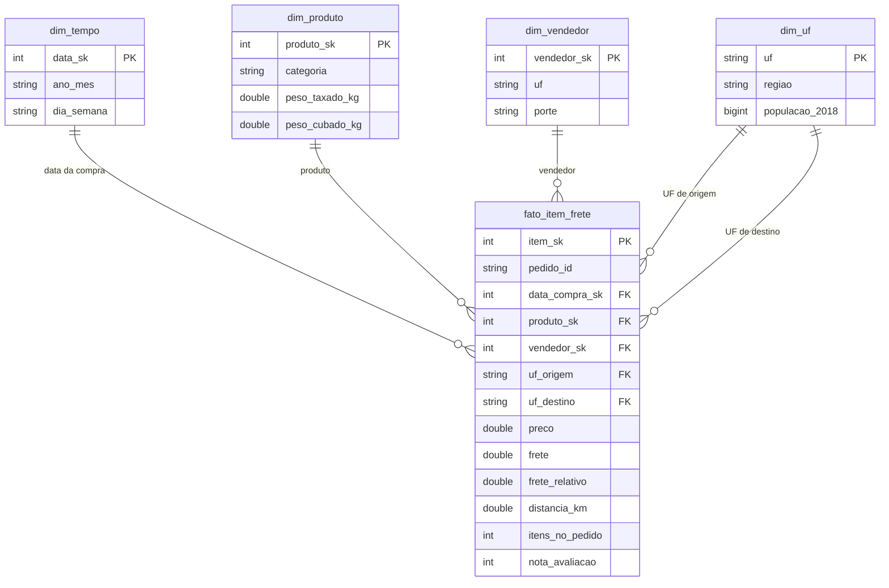
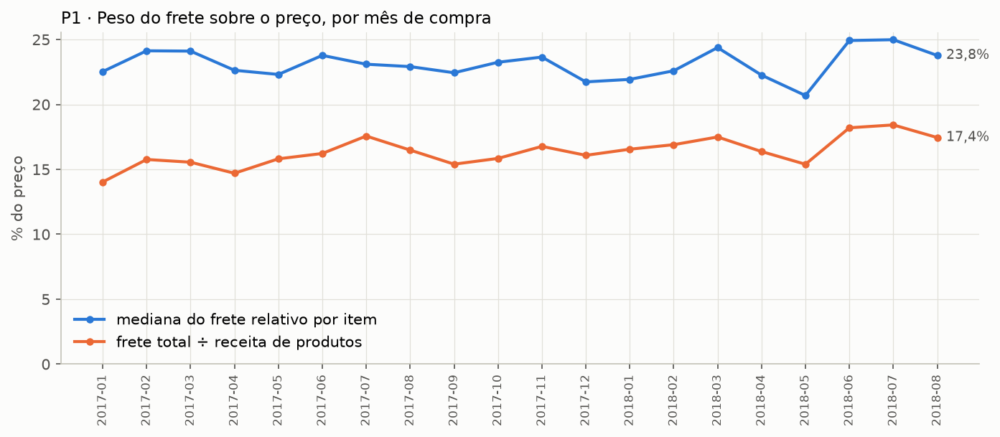
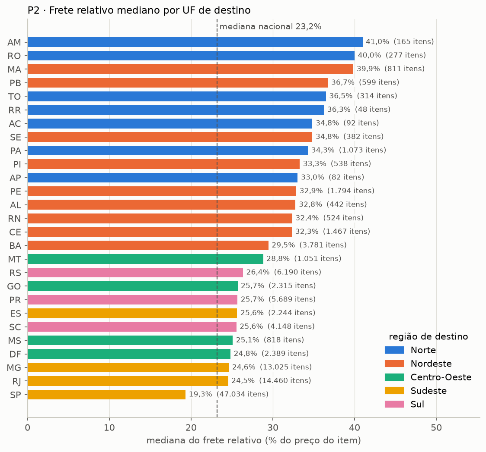
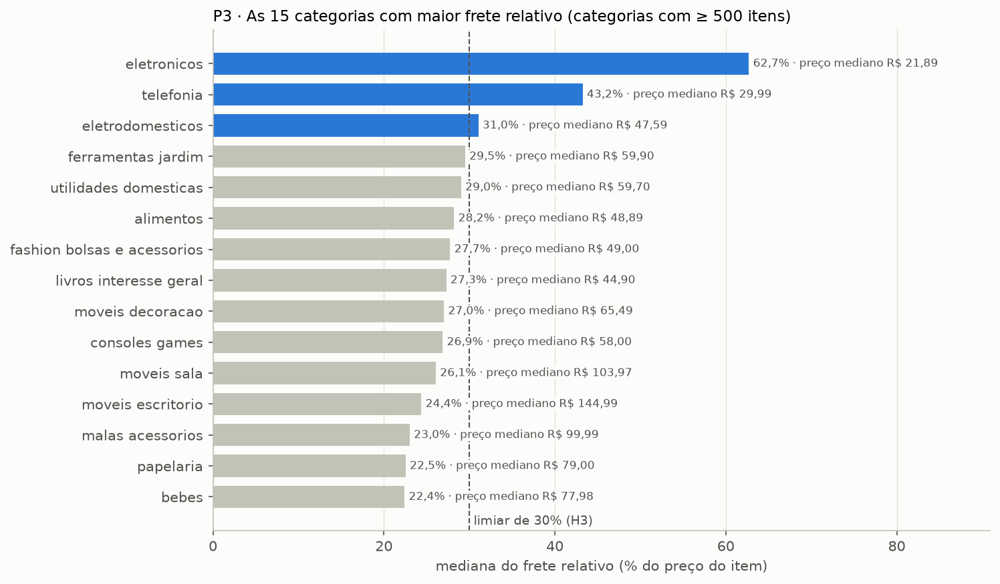
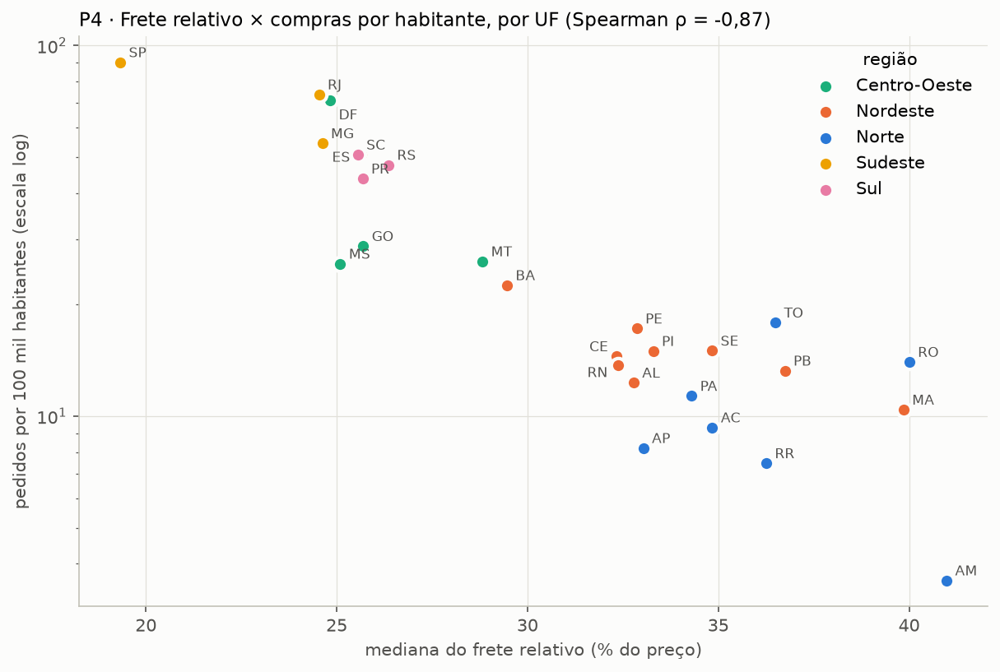
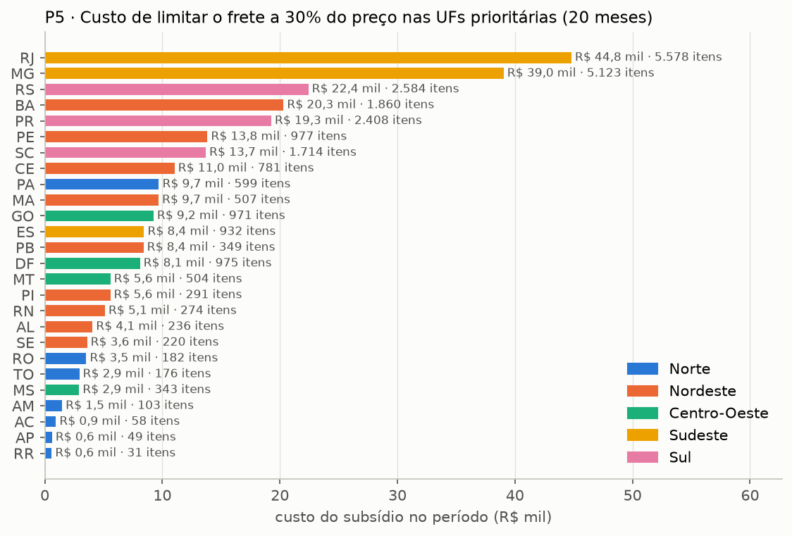

# MVP — Onde subsidiar o frete no e-commerce brasileiro: pipeline de dados em nuvem (Databricks)


| | |
|---|---|
| **Instituição** | Universidade de Brasília (UnB) — Departamento de Engenharia de Produção |
| **Disciplina** | Sistemas de Suporte à Decisão |
| **Professor** | André Luiz Marques Serrano |
| **Aluna** | Brunna Gavião Moraes — matrícula 231025341 |
| **Natureza** | Trabalho individual |

> **Resumo.** O frete pesa sobre o preço de quem compra longe dos vendedores. Este MVP constrói um pipeline de dados no
> **Databricks** sobre cerca de 112 mil itens vendidos na Olist (jan/2017 a ago/2018), cruzados com a população
> estimada por UF do **IBGE**:
> * a camada **bronze** guarda os CSVs originais em um Volume do Unity Catalog;
> * a camada **silver** guarda as tabelas Delta limpas;
> * a camada **gold** guarda um esquema estrela com Catálogo de Dados e restrições.
>
> Com ele, o MVP responde a cinco perguntas que apoiam uma decisão: **em quais estados e categorias subsidiar ou
> renegociar o frete, e quanto isso custaria.**

### Principais resultados

* O frete equivale a **16,6% da receita de produtos**. No item típico, é **23,2% do preço**, e **36,6% dos itens**
  pagam frete acima de 30% do preço. O patamar é **estável** nos 20 meses analisados.
* O frete relativo do **Maranhão (39,9%) é 2,06× o de São Paulo (19,3%)**. As 15 UFs com frete relativo mais alto são
  todas do Norte e do Nordeste.
* **Distância, peso e preço explicam 68%** da diferença de frete entre Norte/Nordeste e Sudeste. Os 32% restantes são
  o espaço para renegociar com transportadoras.
* O frete fica perto de **R$ 15 mesmo em produtos baratos**. Por isso, o frete relativo passa de 62% nos itens de até
  R$ 30. O problema está no **preço baixo**, não no peso.
* UFs com frete mais caro compram **muito menos por habitante** (Spearman ρ = −0,87). É uma associação, não prova de
  causa.
* Subsidiar o frete acima de 30% do preço **só no Norte e Nordeste** custaria cerca de **R$ 5,1 mil/mês, 0,75% da
  receita**. A regra de priorização fixada antes da análise custaria 2,04% e não passou no critério de 2%.

## Sumário

1. [Objetivo](#1-objetivo)
2. [Arquitetura e plataforma](#2-arquitetura-e-plataforma)
3. [Como reproduzir](#3-como-reproduzir)
4. [Busca e coleta](#4-busca-e-coleta)
5. [Qualidade dos dados](#5-qualidade-dos-dados)
6. [Transformação](#6-transformação)
7. [Modelagem e Catálogo de Dados](#7-modelagem-e-catálogo-de-dados)
8. [Carga na camada gold](#8-carga-na-camada-gold)
9. [Análise: solução do problema](#9-análise-solução-do-problema)
10. [Discussão geral](#10-discussão-geral)
11. [Viabilidade financeira](#11-viabilidade-financeira)
12. [Autoavaliação](#12-autoavaliação)
13. [Ética, licenciamento e proteção de dados](#13-ética-licenciamento-e-proteção-de-dados)
14. [Estrutura do repositório](#14-estrutura-do-repositório)
15. [Referências](#15-referências)

---

## 1. Objetivo

### Problema

A Olist conecta pequenos vendedores a grandes canais de venda. Os vendedores ficam concentrados no Sudeste, e os
clientes estão no país inteiro. O frete é pago pelo comprador e aparece **antes** da compra, junto ao preço. Quando o
frete se aproxima do valor do produto, a compra perde atratividade.

**Decisão a apoiar:** a plataforma pode subsidiar parte do frete, renegociar rotas com transportadoras ou mudar regras
comerciais (frete mínimo, kits, frete grátis acima de um valor). Para escolher, o gestor precisa saber três coisas:
* **onde** o frete pesa mais (estados e categorias);
* **por quê** (distância, peso ou preço);
* **quanto** custaria um subsídio.

### Perguntas de negócio

| # | Pergunta | Decisão que a resposta apoia |
|---|---|---|
| **P1** | Quanto o frete representa do valor dos pedidos (frete ÷ preço) e como isso evoluiu mês a mês entre jan/2017 e ago/2018? | Dimensionar o problema e decidir se pede ação pontual ou política permanente. |
| **P2** | Em quais UFs de destino o frete relativo é mais alto, e quanto disso se explica pela distância e pelo peso? | Escolher regiões prioritárias e separar o que é geografia do que é negociável. |
| **P3** | Quais categorias têm frete desproporcional ao preço (produto barato, mas pesado ou volumoso)? | Escolher categorias prioritárias ou regras comerciais por tipo de produto. |
| **P4** | As UFs com frete mais caro compram menos por habitante? | Estimar a demanda que o frete pode estar reprimindo. |
| **P5** | Quanto custaria subsidiar a parte do frete que passa de 30% do preço nas UFs prioritárias? | Justificar (ou não) o investimento. |

### Hipóteses e critérios de confirmação (definidos antes da análise)

| Hipótese | Enunciado | Critério de confirmação |
|---|---|---|
| **H2** | O frete relativo é desigual entre UFs. | Entre as UFs com ≥ 300 itens, a mediana do frete relativo da mais cara é **≥ 2×** a da mais barata. |
| **H3** | Há categorias com frete desproporcional ao preço. | **≥ 5 categorias** (com ≥ 500 itens) têm mediana do frete relativo **≥ 30%**. |
| **H4** | Onde o frete é mais caro, compra-se menos. | Correlação de Spearman entre o frete relativo mediano e os pedidos por 100 mil habitantes **< 0** com p < 0,05 (27 UFs). |
| **H5** | O subsídio é financeiramente viável. | Custo de limitar o frete a 30% do preço nas UFs prioritárias **≤ 2%** da receita de produtos. |

**Definições:**
* **Frete relativo** = frete do item ÷ preço do item.
* **UFs prioritárias** = UFs cuja mediana de frete relativo supera a mediana nacional.

As hipóteses são numeradas pela pergunta que testam; a P1 é descritiva e serve de linha de base.

**Escopo:** compras de jan/2017 a ago/2018 que geraram envio, ou seja, sem cancelados e indisponíveis.

**Fora do escopo:**
* conversão e carrinhos abandonados (ausentes da base);
* custo real das transportadoras;
* previsão de frete com aprendizado de máquina.

### As três dimensões do MVP

| Dimensão | Evidência neste trabalho |
|---|---|
| Viabilidade técnica | Pipeline ponta a ponta no Databricks, com dados persistidos no Unity Catalog ([seções 4 a 8](#4-busca-e-coleta)). |
| Viabilidade financeira | Armazenamento medido, custo da plataforma e custo do subsídio estimado ([seções 9 e 11](#11-viabilidade-financeira)). |
| Desejabilidade | P1 a P5 respondidas com dados e discutidas criticamente ([seções 9 e 10](#9-análise-solução-do-problema)). |

## 2. Arquitetura e plataforma



| Camada | Onde (Unity Catalog) | Formato | Conteúdo |
|---|---|---|---|
| Bronze | `workspace.frete_bronze` · Volume `arquivos/coleta=AAAA-MM-DD/` | CSV | 10 arquivos exatamente como baixados + `_metadados_coleta.json` (data, forma de acesso, linhas, SHA-256) |
| Silver | `workspace.frete_silver` | Delta | `pedidos`, `itens`, `clientes`, `vendedores`, `produtos`, `avaliacoes`, `geo_cep`, `ibge_uf` + `meta_log_transformacoes` |
| Gold | `workspace.frete_gold` | Delta | `fato_item_frete`, `dim_tempo`, `dim_produto`, `dim_vendedor`, `dim_uf` + `meta_log_transformacoes`, `meta_catalogo`, `meta_validacao_catalogo` |

**Por que o Databricks.** É a plataforma apoiada pela disciplina, e a **Free Edition** não tem custo.
* O **Unity Catalog** organiza as três camadas como schemas e guarda os arquivos brutos em um **Volume**.
* As tabelas **Delta** aceitam comentários de coluna, restrições `CHECK` e chaves primárias e estrangeiras
  informativas. Com isso, o Catálogo de Dados fica **dentro** do Data Warehouse, e não só no README.
* A computação *serverless* dispensa configurar cluster.

**Um único código para nuvem e teste.** O módulo [`scripts/mvp_frete.py`](scripts/mvp_frete.py) isola a plataforma
na classe `Plataforma`:
* **no Databricks**, ela grava tabelas Delta e executa SQL no Spark;
* **fora dele**, grava Parquet e consulta com DuckDB.

Os notebooks são os mesmos nos dois ambientes. O modo local serviu para testar o pipeline antes da execução na nuvem.

## 3. Como reproduzir

1. Crie uma conta gratuita no **Databricks Free Edition**: <https://www.databricks.com/learn/free-edition>.
2. No workspace, clique em **Workspace → Create → Git folder** e cole a URL deste repositório. Ele é público e não
   precisa de credencial.
3. Abra a pasta `notebooks/` e execute, **nesta ordem**, cada notebook com **Run all** na computação *Serverless*:
   `01_coleta_bronze` → `02_qualidade_transformacao` → `03_modelagem_carga_gold` → `04_analise`.
4. **Plano B da coleta:** se o ambiente bloquear o download do Kaggle, envie os 9 CSVs da Olist para o Volume
   `workspace.frete_bronze.arquivos`, na pasta `upload_manual/`, e execute o notebook 01 de novo. A população do IBGE
   tem cópia versionada em [`dados/`](dados/).

O pipeline é **idempotente**: reexecutar recria as tabelas, sem duplicar linhas.

## 4. Busca e coleta

**Fontes.** A base foi escolhida **depois** do problema, porque tem o que as perguntas exigem:
* preço e frete por item;
* CEP do vendedor e do cliente, com tabela de geolocalização para medir a distância;
* peso e dimensões do produto, para calcular o peso cubado e o peso taxado;
* categoria e data da compra.

A população por UF não está na Olist. Ela vem do IBGE e é **conciliada pela sigla da UF** (regra R12).

| Fonte | Conteúdo | Licença | Coleta |
|---|---|---|---|
| [Brazilian E-Commerce Public Dataset by Olist](https://www.kaggle.com/datasets/olistbr/brazilian-ecommerce) (Kaggle, versão 2) | Pedidos reais de 2016–2018, 9 arquivos relacionais | CC BY-NC-SA 4.0 | API pública do Kaggle (`kagglehub`), sem *web scraping* |
| [IBGE — SIDRA, tabela 6579](https://sidra.ibge.gov.br/tabela/6579) | População residente estimada por UF, 2018 (ano do meio da janela) | Dados públicos | API SIDRA (`apisidra.ibge.gov.br`) |

| Item | Valor registrado |
|---|---|
| **Data da coleta** | [DATA DA COLETA NO DATABRICKS] — ver [`evidencias/metadados/_metadados_coleta.json`](evidencias/metadados/_metadados_coleta.json) |
| **Formato original** | 10 arquivos CSV (UTF-8, separador vírgula) |
| **Volume** | 120,35 MB · 1.550.949 registros (1.550.922 da Olist + 27 do IBGE) |
| **Pasta na bronze** | `/Volumes/workspace/frete_bronze/arquivos/coleta=AAAA-MM-DD/` |

| Arquivo | Conteúdo | Registros | Colunas | MB |
|---|---|---:|---:|---:|
| `olist_orders_dataset.csv` | Pedidos, status e datas | 99.441 | 8 | 16,84 |
| `olist_order_items_dataset.csv` | Itens, vendedor, **preço e frete** | 112.650 | 7 | 14,72 |
| `olist_customers_dataset.csv` | Cliente, CEP e UF | 99.441 | 5 | 8,62 |
| `olist_sellers_dataset.csv` | Vendedor, CEP e UF | 3.095 | 4 | 0,17 |
| `olist_products_dataset.csv` | Categoria, **peso e dimensões** | 32.951 | 9 | 2,27 |
| `olist_order_reviews_dataset.csv` | Avaliações | 99.224 | 7 | 13,78 |
| `olist_order_payments_dataset.csv` | Pagamentos (coletado, fora do escopo) | 103.886 | 5 | 5,51 |
| `olist_geolocation_dataset.csv` | Coordenadas por prefixo de CEP | 1.000.163 | 5 | 58,44 |
| `product_category_name_translation.csv` | Tradução das categorias (não usada: os nomes ficam em português) | 71 | 2 | < 0,01 |
| `ibge_populacao_uf_2018.csv` | População estimada 2018 por UF | 27 | 4 | < 0,01 |

O hash **SHA-256** de cada arquivo fica no `_metadados_coleta.json`. O notebook 02 confere os hashes antes de ler a
bronze: se um arquivo for alterado depois da coleta, o pipeline para.

> 📷 Evidência: [`evidencias/01_volume_bronze.png`](evidencias/01_volume_bronze.png) — Volume da bronze no Catalog Explorer.

## 5. Qualidade dos dados

A análise foi feita **antes** da transformação, porque é ela que define as regras (notebook 02). Tem três partes:

1. **Perfil dos 56 atributos** dos 10 arquivos: tipo esperado, nulos, distintos, % de conformidade ao tipo, mínimo,
   máximo e valores mais frequentes → [`q1_perfil_por_atributo.csv`](evidencias/tabelas/q1_perfil_por_atributo.csv).
2. **33 verificações em sete dimensões**, cada uma ligada a um tratamento. As que não encontram problema também ficam
   registradas → [`q2_verificacoes_por_dimensao.csv`](evidencias/tabelas/q2_verificacoes_por_dimensao.csv).
3. **Atualidade:** volume mensal e definição da janela de análise.

| Dimensão | Principais achados | Tratamento |
|---|---|---|
| Completude | 610 produtos sem categoria (1,9%); 2 sem peso ou medidas; 775 pedidos sem itens; 768 pedidos sem avaliação | R05, R06, R08; nota opcional na fato |
| Unicidade | Nenhuma chave duplicada; 547 pedidos com mais de uma avaliação; 26% de linhas repetidas na geolocalização | R07 (última avaliação), R04 (centroide por CEP) |
| Conformidade | CEPs, UFs, notas e status dentro do domínio | R02 e R03 padronizam mesmo sem ocorrências |
| Consistência | Nenhuma aprovação antes da compra; 4.124 itens (3,7%) com frete maior que o preço | **Mantidos**: é o fenômeno estudado |
| Acurácia | 42 coordenadas fora do Brasil; 4 produtos com peso zero; 383 itens com frete zero | R04 descarta; R06 trata como ausente; flag `frete_gratis` |
| Integridade | Nenhuma FK órfã entre itens, produtos, vendedores e clientes; 278 CEPs de clientes e 7 de vendedores sem geolocalização | R10: distância nula, sem excluir o item |
| Atualidade | 2016 com volume irrisório; set–out/2018 truncados | R08: janela jan/2017–ago/2018 (20 meses completos) |



A qualidade é verificada de novo **depois** da transformação, contra os domínios do Catálogo de Dados
([seção 7](#7-modelagem-e-catálogo-de-dados)), e **depois da carga**, por SQL na própria gold
([seção 8](#8-carga-na-camada-gold)).

## 6. Transformação

Dezesseis regras de negócio levam da bronze à gold. Cada uma registra quantas linhas afetou em
`meta_log_transformacoes`, nas camadas silver e gold, e isso compõe a linhagem. A lista completa, com as justificativas,
está em [`catalogo/regras_transformacao.md`](catalogo/regras_transformacao.md). As regras que mais afetam a
interpretação dos resultados são:

* **R06 — peso cubado e peso taxado.** As transportadoras cobram pelo maior entre o peso real e o peso cubado
  (C × A × L ÷ 6.000, em kg). Sem essa conversão, produtos leves e volumosos pareceriam baratos de enviar.
* **R08 — escopo.** Compras de jan/2017 a ago/2018, exceto pedidos cancelados ou indisponíveis, que não geraram envio.
* **R09 — frete relativo** = frete ÷ preço do item. A Olist rateia o frete do pedido entre os itens, por isso a medida é
  calculada no item.
* **R10 — distância.** Fórmula de Haversine entre os centroides dos CEPs do vendedor e do cliente. É linha reta, não
  rota rodoviária.
* **R12 — conciliação Olist × IBGE.** O código IBGE da UF vira sigla, a chave comum às duas bases.
* **R13 — minimização (LGPD).** O identificador único do cliente e o texto das avaliações não seguem para silver e gold.

## 7. Modelagem e Catálogo de Dados



* **Esquema estrela**, com o **grão no item vendido** (pedido × sequência do item). É o nível em que a Olist registra
  preço e frete. O grão por pedido misturaria categorias e pesos diferentes, o que inviabilizaria a P3.
* **`dim_uf` tem dois papéis:** UF de origem (vendedor) e UF de destino (cliente). É nela que entra a população do
  IBGE, conciliada na regra R12.
* A justificativa completa está em [`catalogo/modelo_dados.md`](catalogo/modelo_dados.md).

O **[Catálogo de Dados](catalogo/catalogo_dados.md)** descreve os **54 atributos** do modelo: tipo, descrição, domínio
(faixa mínima e máxima ou valores válidos), obrigatoriedade, significado do nulo e linhagem. Ele é definido **uma única
vez**, em `CATALOGO_GOLD` no módulo [`mvp_frete.py`](scripts/mvp_frete.py), e dele saem cinco produtos:

1. a documentação ([`catalogo_dados.md`](catalogo/catalogo_dados.md) e [`.csv`](catalogo/catalogo_dados.csv));
2. o **esquema** das tabelas Delta (tipos explícitos) e o DDL de referência
   ([`scripts/ddl_modelo_estrela.sql`](scripts/ddl_modelo_estrela.sql));
3. os **comentários** de tabela e de coluna, visíveis no Catalog Explorer;
4. as **restrições** gravadas no Delta: 41 `NOT NULL`, 41 `CHECK` com os domínios, 5 `PRIMARY KEY` e 5 `FOREIGN KEY`;
5. a **validação automática** antes da carga: 54 de 54 atributos aprovados →
   [`m1_validacao_catalogo.csv`](evidencias/tabelas/m1_validacao_catalogo.csv).

> 📷 Evidências: [`04_gold_colunas_fato.png`](evidencias/04_gold_colunas_fato.png) (comentários das colunas) ·
> [`05_gold_diagrama_er.png`](evidencias/05_gold_diagrama_er.png) (diagrama gerado pelo Databricks a partir das PK/FK).

## 8. Carga na camada gold

O pipeline é **ETL**: extração (seção 4), transformação em pandas (seções 6 e 7) e carga em tabelas Delta no Unity
Catalog. A carga tem três características:

* **é idempotente:** `DROP TABLE` (fato primeiro, por causa das FKs) e depois `CREATE`, de modo que reexecutar não
  duplica linhas;
* **tem esquema explícito vindo do catálogo:** cada coluna é convertida para o tipo declarado;
* **tem restrições aplicadas depois da carga:** um `CHECK` só é aceito se **todos** os dados já gravados respeitarem o
  domínio, então a própria nuvem confirma a validação.

Depois da carga, o notebook 03 consulta a gold **por SQL**:

| Verificação | Resultado | Evidência |
|---|---|---|
| Linhas validadas × linhas gravadas nas 5 tabelas | iguais (fato: 111.752; dim_produto: 32.578; dim_vendedor: 3.029; dim_tempo: 608; dim_uf: 27) | [`c1_log_carga.csv`](evidencias/tabelas/c1_log_carga.csv) |
| Restrições aplicadas | comentários, NOT NULL, CHECK, PK e FK | [`c2_restricoes_aplicadas.csv`](evidencias/tabelas/c2_restricoes_aplicadas.csv) |
| Unicidade das 5 chaves primárias | todas únicas | [`c3`](evidencias/tabelas/c3_unicidade_chaves.csv) · [SQL](scripts/sql/c3_unicidade_chaves.sql) |
| Registros órfãos nas 5 chaves estrangeiras | 0 | [`c4`](evidencias/tabelas/c4_integridade_referencial.csv) · [SQL](scripts/sql/c4_integridade_referencial.sql) |
| Reconciliação silver × gold (itens, receita, frete) | idêntica | [`c5`](evidencias/tabelas/c5_reconciliacao_silver_gold.csv) · [SQL](scripts/sql/c5_reconciliacao_silver_gold.sql) |

> 📷 Evidências: [`02_silver_tabelas.png`](evidencias/02_silver_tabelas.png) · [`03_gold_tabelas.png`](evidencias/03_gold_tabelas.png)

## 9. Análise: solução do problema

Todas as respostas partem de **consultas SQL sobre a gold**, guardadas em [`scripts/sql/`](scripts/sql/). O Python
entra só nos testes estatísticos (Spearman e regressão OLS com erros robustos) e nos gráficos. Os resultados completos
estão no notebook [`04_analise`](notebooks/04_analise.ipynb) e em [`evidencias/tabelas/`](evidencias/tabelas/).

### P1 — Quanto o frete pesa e como evoluiu



* Em 111.752 itens e 97.905 pedidos, o frete soma **R$ 2,23 milhões**, ou **16,6%** dos R$ 13,4 milhões em produtos.
* No item típico, o frete é **23,2% do preço**. **36,6%** dos itens pagam frete acima de 30% do preço, e **3,7%**
  pagam frete maior que o produto.
* A mediana mensal oscila entre 20,7% e 25,0%, **sem tendência** (Spearman com o tempo ρ = 0,06; p = 0,82). Nem a
  Black Friday mudou o patamar.

**Leitura:** o problema é estrutural e pede uma *política* de frete, não uma campanha.

### P2 — Onde o frete relativo é mais alto e o que o explica



* **As 15 UFs com frete relativo mais alto são do Norte e do Nordeste.** Entre as UFs com pelo menos 300 itens, o
  Maranhão (39,9%) paga **2,06×** o frete relativo de São Paulo (19,3%).
* A regressão log-log, com 110.803 itens, explica **49,5%** da variação do frete. As elasticidades são:

| Fator | Elasticidade | IC 95% |
|---|---:|---|
| Distância | 0,194 | 0,192 a 0,195 |
| Peso taxado | 0,146 | 0,144 a 0,149 |
| Preço | 0,134 | 0,132 a 0,137 |

* Acrescentar a UF de destino ao modelo eleva o R² em só **3,3 pontos**.
* O frete típico para o Norte e Nordeste é **89% maior** que para o Sudeste (média geométrica de R$ 28,59 contra
  R$ 15,12). **68%** dessa diferença se explica por distância, peso e preço.

**Leitura:** a desigualdade é, na maior parte, **geográfica**. Os 32% que sobram são a margem para renegociar com
transportadoras. O resto se reduz com estoque mais perto do cliente ou com subsídio.

### P3 — Categorias com frete desproporcional



| Faixa de preço | Itens | Frete mediano | Frete relativo mediano | Itens com frete > 30% |
|---|---:|---:|---:|---:|
| até R$ 30 | 20.130 | R$ 14,10 | **62,2%** | 91,7% |
| R$ 30–50 | 18.880 | R$ 15,10 | 35,3% | 67,9% |
| R$ 50–100 | 32.780 | R$ 16,18 | 22,3% | 20,6% |
| R$ 100–200 | 26.759 | R$ 18,54 | 13,6% | 9,2% |
| acima de R$ 200 | 13.203 | R$ 22,90 | 7,0% | 3,1% |

* Só **3 de 30 categorias** (com pelo menos 500 itens) passam de 30% de frete relativo:
  * eletrônicos: 62,7%, com preço mediano de R$ 21,89;
  * telefonia: 43,2%, com R$ 29,99;
  * eletrodomésticos: 31,0%, com R$ 47,59.
* **O que pesa é o preço baixo, não o peso.** O frete funciona como um **piso de cerca de R$ 15**, como mostra a tabela
  acima. Categorias pesadas, como móveis de escritório (13 kg taxados), pagam mais em reais, mas ficam em 24% de frete
  relativo.
* O peso cubado supera o real em **80% dos eletrônicos**, o que aponta para embalagens superdimensionadas.

### P4 — Frete mais caro, menos compras por habitante?



* **ρ = −0,87** entre o frete relativo e os pedidos por 100 mil habitantes (p < 0,001; 27 UFs). O resultado se mantém
  sem São Paulo (ρ = −0,85).
* São Paulo tem 90 pedidos por 100 mil habitantes; Maranhão, Amapá e Roraima ficam entre 8 e 10.
* **Cautela:** a distância média sozinha tem correlação ainda mais forte (ρ = −0,94), e renda e acesso à internet,
  ausentes da base, caem nas mesmas UFs.

**Leitura:** frete caro e baixa penetração **andam juntos**. Medir quanto o frete *causa* exige um experimento.

### P5 — Quanto custaria o subsídio



* Limitar o frete a 30% do preço nas **UFs prioritárias**, conforme a regra fixada antes da análise, custaria
  **R$ 274,9 mil em 20 meses** (R$ 13,7 mil/mês). Isso é **2,04%** da receita de produtos, para 27.825 itens.
* A regra **não foi seletiva**: São Paulo concentra 42% dos itens e puxa a mediana nacional para baixo, então **26 das
  27 UFs** ficaram acima dela.

Sensibilidade ([`p5_sensibilidade.csv`](evidencias/tabelas/p5_sensibilidade.csv)), em % da receita de produtos:

| Limite do frete | UFs prioritárias (26) | Todas as UFs | Norte e Nordeste (exploratório) |
|---|---:|---:|---:|
| 20% do preço | 3,50% | 4,55% | 1,17% |
| **30% do preço** | **2,04%** | 2,57% | **0,75%** (R$ 5,1 mil/mês) |
| 40% do preço | 1,28% | 1,57% | 0,50% |
| 50% do preço | 0,84% | 1,01% | 0,35% |

## 10. Discussão geral

### Avaliação das hipóteses (critérios definidos antes da análise)

| Hipótese | Critério | Resultado | Veredito |
|---|---|---|---|
| **H2** — frete relativo desigual entre UFs | mais cara ≥ 2× a mais barata (UFs ≥ 300 itens) | **2,06×** (MA 39,9% × SP 19,3%) | ✅ Confirmada |
| **H3** — categorias com frete desproporcional | ≥ 5 categorias com mediana ≥ 30% | **3 categorias** | ❌ Refutada |
| **H4** — frete caro, menos compras por habitante | Spearman < 0, p < 0,05 | **ρ = −0,87** (p < 0,001) | ✅ Confirmada (associação, não causa) |
| **H5** — subsídio viável | custo ≤ 2% da receita | **2,04%** | ❌ Refutada (por pouco) |

As duas hipóteses refutadas também ensinam algo:
* **H3:** o frete caro não é um problema de *categoria*, e sim de *preço baixo*.
* **H5:** a regra de priorização pela mediana nacional seleciona quase todas as UFs, porque São Paulo concentra o
  volume. O critério deveria ter sido regional ou por distância.

### Resposta ao problema: onde agir?

| Prioridade | Ação | Evidência | Custo estimado |
|---|---|---|---|
| 1 | **Subsídio focado no Norte e Nordeste**, limitando o frete a 30% do preço | P2 e P4; cenário de P5 | ~R$ 5,1 mil/mês (0,75% da receita) |
| 2 | **Renegociar transportadoras** nas rotas para o Norte e Nordeste | 32% da diferença regional não se explica por distância, peso ou preço (P2) | Custo de negociação |
| 3 | **Política para itens baratos:** frete grátis acima de um valor mínimo, kits e agrupamento de envios; revisão de embalagem em eletrônicos | Piso de ~R$ 15 e 62% de frete relativo até R$ 30; peso cubado maior que o real em 80% dos eletrônicos (P3) | Baixo (regra comercial) |
| 4 | **Testar antes de escalar:** subsídio em parte das UFs ou CEPs, com grupo de controle | A P4 é correlação, não causalidade | Baixo |

## 11. Viabilidade financeira

| Item | Medida |
|---|---|
| Plataforma | Databricks **Free Edition**, computação *serverless* — **US$ 0,00** |
| Armazenamento bronze (CSV originais) | 120,35 MB |
| Armazenamento gold (Delta, modelo + metadados) | ≈ 8 MB → [`f1_armazenamento_gold.csv`](evidencias/tabelas/f1_armazenamento_gold.csv) |
| Execução completa (4 notebooks) | [TEMPO MEDIDO NO DATABRICKS] na computação *serverless* (cerca de 2,5 min no teste local) |
| Custo da ação recomendada (prioridade 1) | ≈ R$ 5,1 mil/mês, ou 0,75% da receita de produtos |

* **O MVP em si não tem custo de operação.** O volume cabe com folga nos limites da Free Edition.
* **Numa operação contínua**, o mesmo pipeline rodaria em um workspace pago com um *Job* agendado. Para cerca de 120 MB
  por carga, o consumo de computação é de minutos por execução.
* **O custo relevante para a decisão é o do subsídio**, estimado na P5.

## 12. Autoavaliação

**Quais perguntas foram respondidas e quais não foram?**
* As cinco perguntas foram respondidas, com evidência e discussão.
* A **P4** foi respondida só como **associação**: a base não permite separar o efeito do frete do efeito da distância e
  da renda.
* A **P5** respondeu o custo, mas não o **retorno**: sem dados de carrinhos abandonados, não dá para estimar quantas
  vendas o subsídio traria.

**Que limitações dos dados condicionaram os resultados?**
* Não há custo real nem identificação da transportadora, então não se sabe quanto do frete é margem.
* A distância é em linha reta entre centroides de CEP, não a rota real.
* O frete do pedido é rateado entre os itens pela própria Olist, o que pode distorcer o frete relativo em pedidos com
  vários itens.
* Não há renda por UF na base.
* Os dados são de 2017–2018, e preços e tabelas de frete mudaram desde então.

**Que decisões técnicas eu tomaria de outra forma?**
* **Definir as UFs prioritárias por região ou faixa de distância,** e não pela mediana nacional. A regra escolhida
  acabou não sendo seletiva, por causa do peso de São Paulo.
* **Incluir a renda per capita do IBGE como segunda conciliação,** para controlar a P4.
* **Fazer as transformações em PySpark** em vez de pandas. Para este volume, o pandas é mais simples, mas o PySpark
  escalaria para cargas maiores.

**Que extensões tornariam o MVP uma solução de uso contínuo?**
* **Cargas incrementais** agendadas com *Databricks Jobs* (*Workflows*), com o log de linhagem acumulando execuções.
* **Painel no Databricks SQL** (*AI/BI Dashboard*) sobre a gold, para o gestor acompanhar o frete relativo por UF e por
  faixa de preço.
* **Experimento controlado de subsídio** para medir o efeito causal sobre as vendas.
* **Dados de custo das transportadoras** para separar margem e custo logístico.

## 13. Ética, licenciamento e proteção de dados

* **Licença dos dados da Olist: CC BY-NC-SA 4.0.** Ela permite uso não comercial com atribuição e compartilhamento
  pela mesma licença.
  * Este trabalho é acadêmico e cita a fonte.
  * Os CSVs da Olist **não são versionados** no repositório: o notebook 01 baixa direto da fonte, e só tabelas
    agregadas aparecem em `evidencias/`.
* **IBGE:** dados públicos. A pequena tabela de população por UF fica versionada em `dados/` como plano B da coleta.
* **LGPD (Lei nº 13.709/2018):** a base já é anonimizada (identificadores em *hash*, sem nomes nem endereços). Mesmo
  assim, a regra R13 aplica **minimização**: o identificador único do cliente e o texto livre das avaliações não seguem
  para silver e gold, porque nenhuma pergunta precisa deles.
* **Dados corporativos:** não foram usados.
* **Código:** licença MIT ([`LICENSE`](LICENSE)).
* **Referência de organização:** a estrutura deste repositório (camadas, catálogo que gera esquema e validação, log de
  linhagem, hipóteses com critério fixado antes) se inspirou no MVP de João Pedro Lima de Carvalho, da mesma
  disciplina ([jplc08/mvp-pipeline-entregas-olist](https://github.com/jplc08/mvp-pipeline-entregas-olist)), que trata
  de outro problema (atraso de entregas) em outra plataforma (Google Drive + BigQuery). Problema, perguntas, segunda
  fonte de dados, plataforma, código e análise deste trabalho são próprios.

## 14. Estrutura do repositório

```
├── README.md                          documento principal (este arquivo)
├── LICENSE                            MIT (código) + registro das licenças dos dados
├── requirements.txt                   dependências para a execução local de teste
├── notebooks/
│   ├── 01_coleta_bronze.ipynb         coleta Kaggle + IBGE → Volume da bronze, com SHA-256
│   ├── 02_qualidade_transformacao.ipynb  perfil, 33 verificações, regras R01–R13 → silver
│   ├── 03_modelagem_carga_gold.ipynb  estrela, catálogo, validação, carga, PK/FK/CHECK, conferências SQL
│   └── 04_analise.ipynb               P1–P5, hipóteses, viabilidade financeira
├── scripts/
│   ├── mvp_frete.py                   módulo de apoio: plataforma, qualidade, regras, catálogo
│   ├── ddl_modelo_estrela.sql         DDL do modelo (gerado do catálogo)
│   └── sql/                           todas as consultas de conferência e de análise
├── catalogo/
│   ├── catalogo_dados.md / .csv       Catálogo de Dados (54 atributos)
│   ├── modelo_dados.md                modelo estrela, grão e justificativas
│   └── regras_transformacao.md        regras R01–R16 com justificativas
├── dados/
│   └── ibge_populacao_uf_2018.csv     cópia da população por UF (plano B da coleta)
└── evidencias/
    ├── README.md                      lista das capturas de tela
    ├── *.png                          capturas da execução no Databricks
    ├── graficos/                      gráficos das perguntas
    ├── metadados/                     _metadados_coleta.json
    └── tabelas/                       resultados de qualidade, carga e análise (CSV)
```

## 15. Referências

* BRASIL. Lei nº 13.709, de 14 de agosto de 2018. Lei Geral de Proteção de Dados Pessoais (LGPD).
* DATABRICKS. *Unity Catalog* e *Delta Lake constraints*. Documentação oficial, 2026. <https://docs.databricks.com/>
* IBGE. Estimativas da população residente — SIDRA, tabela 6579. <https://sidra.ibge.gov.br/tabela/6579>
* INMON, W. H. *Building the Data Warehouse*. 4. ed. Indianapolis: Wiley, 2005.
* KIMBALL, R.; ROSS, M. *The Data Warehouse Toolkit: The Definitive Guide to Dimensional Modeling*. 3. ed. Indianapolis: Wiley, 2013.
* OLIST. *Brazilian E-Commerce Public Dataset by Olist*. Kaggle, 2018. <https://www.kaggle.com/datasets/olistbr/brazilian-ecommerce>. Licença CC BY-NC-SA 4.0.
* SPRAGUE, R. H. A framework for the development of decision support systems. *MIS Quarterly*, v. 4, n. 4, p. 1–26, 1980.
* WANG, R. Y.; STRONG, D. M. Beyond accuracy: what data quality means to data consumers. *Journal of Management Information Systems*, v. 12, n. 4, p. 5–33, 1996.
