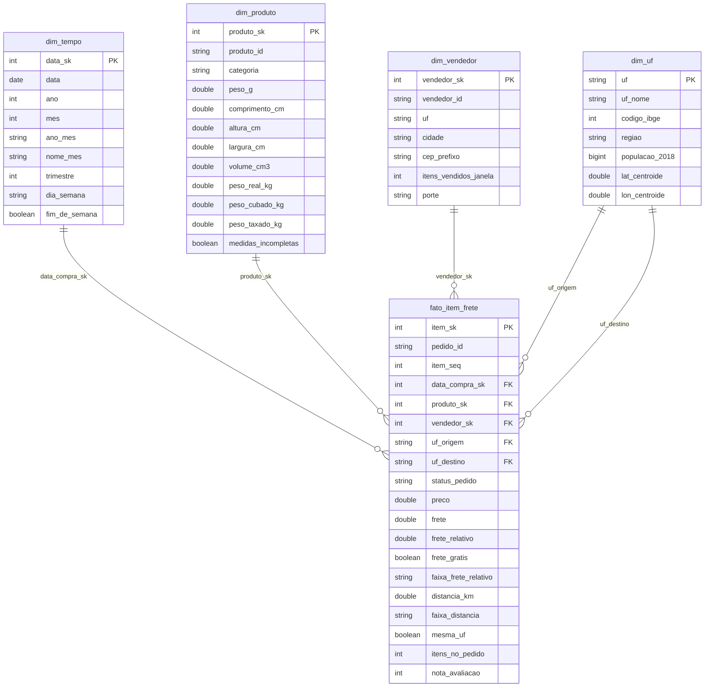

# Modelo de dados — camada gold (`workspace.frete_gold`)

## Esquema estrela



| Tabela | Tipo | Linhas | Chave |
|---|---|---:|---|
| `fato_item_frete` | fato | 111.752 | `item_sk` |
| `dim_produto` | dimensão | 32.578 | `produto_sk` |
| `dim_vendedor` | dimensão | 3.029 | `vendedor_sk` |
| `dim_tempo` | dimensão | 608 | `data_sk` |
| `dim_uf` | dimensão com papéis (origem e destino) | 27 | `uf` |

## Decisões de modelagem

**Grão da fato: o item vendido (pedido × sequência do item).** A Olist registra preço e frete por item; quando um
pedido tem vários itens, ela rateia o frete do pedido entre eles. Três alternativas foram descartadas:

* **Grão por pedido:** misturaria produtos de categorias, pesos e preços diferentes na mesma linha, e a P3 (categoria)
  e o peso taxado da P2 se perderiam.
* **Grão por remessa (pedido × vendedor):** agregaria itens de categorias diferentes do mesmo vendedor, com o mesmo
  problema, em menor grau.
* **Grão por item:** preserva o nível em que preço e frete existem. Medidas de pedido, como a contagem de pedidos por
  habitante na P4, saem com `COUNT(DISTINCT pedido_id)`.

**`dim_uf` com dois papéis.** A mesma dimensão responde como **UF de origem** (vendedor) e **UF de destino** (cliente),
por meio de duas chaves estrangeiras na fato. Isso evita duas dimensões iguais e deixa a análise por rota
(origem → destino) a uma junção de distância.

**A conciliação Olist × IBGE está na dimensão.** A população estimada de 2018 é um atributo de `dim_uf`. A Olist
identifica a UF pela sigla, e o IBGE pelo código numérico; a regra R12 converte o código em sigla, que é a chave comum.

**A distância é uma medida da fato, não uma dimensão.** Ela depende do par de CEPs (origem e destino) de cada item, que
é exatamente o grão da fato. As faixas (`faixa_distancia`) ficam na fato como atributo degenerado, para agrupar sem
junção extra.

**Peso e medidas ficam na `dim_produto`.** São atributos do produto, não da venda; o peso taxado (R06) é calculado uma
vez por produto.

**O modelo não é snowflake.** A região está desnormalizada em `dim_uf`, e a categoria em `dim_produto`. Com 27 UFs e
cerca de 70 categorias, normalizar não economizaria espaço relevante e acrescentaria junções a todas as consultas.

## Linhagem resumida

```
Kaggle olist_order_items  ─┐
Kaggle olist_orders        ├─ R01, R08 ─► silver.itens / silver.pedidos ─┐
Kaggle olist_customers     ├─ R02, R03, R13 ─► silver.clientes ──────────┤
Kaggle olist_sellers       ├─ R02, R03 ─► silver.vendedores ─────────────┤
Kaggle olist_products      ├─ R05, R06 ─► silver.produtos ───────────────┼─ R09–R11, R14–R16 ─► gold (estrela)
Kaggle olist_order_reviews ├─ R07, R13 ─► silver.avaliacoes ─────────────┤
Kaggle olist_geolocation   ├─ R04 ─► silver.geo_cep ─────────────────────┤
IBGE SIDRA 6579            ┘─ R12 ─► silver.ibge_uf ─────────────────────┘
```

A linhagem por atributo está na coluna **Linhagem** do [Catálogo de Dados](catalogo_dados.md).
